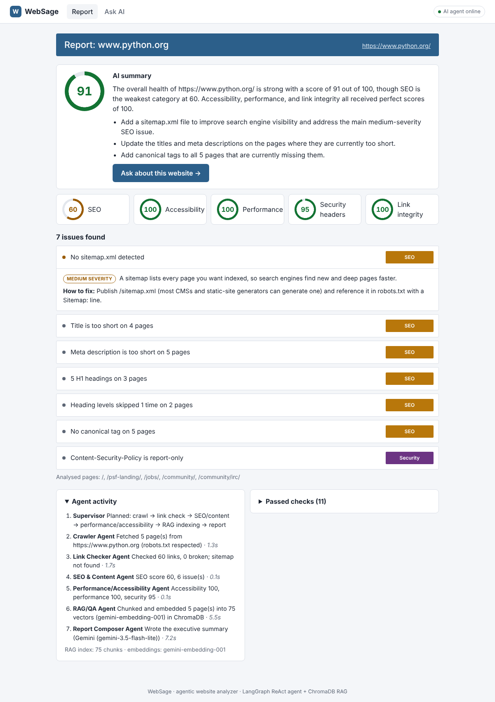
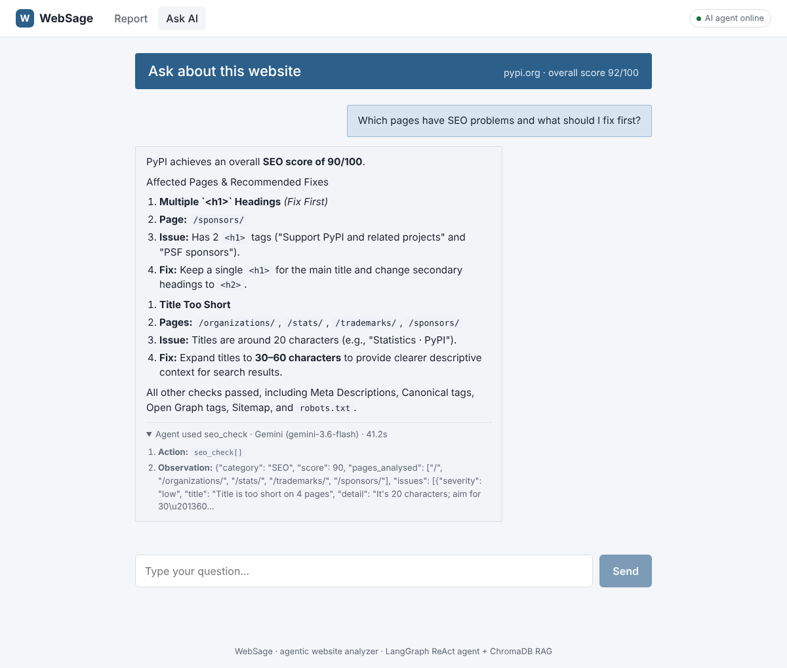

# WebSage – Agentic AI Website Analyzer

     

WebSage is an agentic AI website analyzer. Enter a URL and a team of agents crawls the site, runs SEO,
accessibility, performance, security-header and link-integrity checks, and writes a prioritised summary.
Then you can ask follow-up questions in a chat. A ReAct agent decides which tools to call, and its answers
are grounded in the site's own content through Retrieval-Augmented Generation (RAG).

**Live demo: https://website-analyzer-y8e1.onrender.com**

> Hosted on Render's free plan, so the first visit after 15 idle minutes can take about a minute while the server wakes up.

| Analysis report | RAG follow-up Q&A |
|---|---|
|  |  |

## Features

- **Agentic analysis pipeline.** A supervisor delegates to a Crawler Agent, a Link Checker Agent, an SEO & Content Agent, a Performance/Accessibility Agent, a RAG/QA Agent and a Report Composer Agent. Each step and its duration are shown under "Agent activity".
- **ReAct agent for follow-up questions.** Built with LangGraph. The tools are `scrape_page`, `seo_check`, `accessibility_check`, `performance_check`, `check_links` and `rag_search`. The chat shows each Action and Observation the agent took.
- **RAG pipeline.** HTML is cleaned, split into 500-character chunks with a 50-character overlap, embedded with `gemini-embedding-001` and stored in a per-site ChromaDB collection. Each page's facts and every analysis finding are indexed too, so answers can cite real issues and pages.
- **Multi-page crawl.** The homepage plus up to 4 internal pages. robots.txt is respected, and private or internal addresses are blocked.
- **20 checks in 5 categories**, each scored 0–100. Findings repeated across pages are merged, for example "Missing meta description on 3 pages".
- **Conversation memory, caching and a cost cap.** The agent sees the last 6 turns. Repeated questions are answered from the cache, and each session has a token budget.
- **Safety.** Text scraped from a page is treated as data, never as instructions (prompt-injection rules). The agent declines questions that aren't about the site.
- **Multilingual.** The agent answers in the language you ask in.
- **Resilient.** If one Gemini model is overloaded the next one is tried, with Groq as an optional fallback. Without an API key the app still works, using rule-based answers and local embeddings.

## Architecture

```
React UI (/ , /report/:id , /chat/:id)
        │  REST
FastAPI orchestration layer  ──►  Supervisor pipeline
        │                          ├─ Crawler Agent (robots.txt, ≤5 pages)
        │                          ├─ Link Checker Agent (broken links, sitemap)
        │                          ├─ SEO & Content / Performance & Accessibility Agents (checks.py)
        │                          ├─ RAG/QA Agent ──► chunk → embed (Gemini) → ChromaDB
        │                          └─ Report Composer Agent (Gemini summary)
        │
        └─ /api/chat ──► LangGraph ReAct agent ──► tools ──► ChromaDB / checks / live fetch
                              ▲
                     session memory + tool cache + token budget
```

| Layer | Technology |
|---|---|
| Front end | React 19 + Vite |
| API | FastAPI, Uvicorn |
| Agent framework | LangGraph `create_react_agent`, LangChain tools |
| LLM | Google Gemini (`gemini-3.5-flash`, with other Gemini models as fallbacks), optional Groq Llama 3.3 |
| Embeddings | `gemini-embedding-001`; a local hashed embedding is used when there is no key |
| Vector DB | ChromaDB (in-memory, one collection per analysed site) |
| Scraping | httpx, BeautifulSoup4 |
| Tests | pytest |
| Deployment | Docker (Render.com blueprint included) |

## Project structure

```
backend/
  main.py        FastAPI app: endpoints, sessions, supervisor pipeline, serves the UI
  analyzer.py    crawler, robots.txt, sitemap and broken-link checks
  checks.py      page checks, multi-page merging, scoring
  fetch.py       URL validation, SSRF guard, page and resource fetching
  rag.py         cleaning, chunking, embeddings, ChromaDB index
  agent.py       LLM clients, memory, agent tools, ReAct agent, offline fallback
  prompts.py     system prompt (with few-shot ReAct example) and report-composer prompt
frontend/src/
  Home.jsx       URL entry with live agent progress
  ReportPage.jsx analysis report screen
  ChatPage.jsx   "Ask about this website" RAG chat
tests/           offline pytest suite (no network or key needed)
docs/            project structure and screenshots
Dockerfile       single container for UI + API
render.yaml      one-click Render deployment
```

## Run locally

Requirements: Python 3.11+ and Node.js 20.19+. Get a free Gemini API key at https://aistudio.google.com/apikey.

```bash
# terminal 1: backend
cd backend
python -m venv .venv
source .venv/bin/activate            # Windows: .venv\Scripts\Activate.ps1
pip install -r requirements.txt
export GOOGLE_API_KEY=your-key       # Windows PowerShell: $env:GOOGLE_API_KEY="your-key"
uvicorn main:app --reload --port 8000

# terminal 2: frontend
cd frontend
npm install
npm run dev                          # open http://localhost:5173
```

Or run everything in one container:

```bash
docker build -t websage .
docker run -p 7860:7860 -e GOOGLE_API_KEY=your-key websage   # open http://localhost:7860
```

Run the tests from the repository root with `pytest tests`.

## Deploy

[](https://render.com/deploy?repo=https://github.com/JasNahar/website-analyzer-)

Click the button, sign in with GitHub, paste your `GOOGLE_API_KEY` when asked, and deploy. The free plan
sleeps after 15 idle minutes and takes about a minute to wake up.

## Configuration

| Variable | Purpose |
|---|---|
| `GOOGLE_API_KEY` (or `GEMINI_API_KEY`) | Enables the Gemini agent, the summary and the embeddings |
| `GROQ_API_KEY` | Optional Groq (Llama 3.3) fallback |
| `GEMINI_MODELS` | Comma-separated order to try models in. Default: `gemini-3.5-flash,gemini-3.1-flash-lite,gemini-3.6-flash,gemini-3.5-flash-lite` |
| `SESSION_TOKEN_BUDGET` | Maximum LLM tokens per analysed site (default 150000) |

## API

| Method | Path | Description |
|---|---|---|
| `POST` | `/api/analyze` | Body `{"url": "example.com"}`. Runs the pipeline and returns `{id, report, summary, trace, rag}` |
| `GET` | `/api/report/{id}` | The stored report plus chat history |
| `POST` | `/api/chat/{id}` | Body `{"message": "..."}`. Returns `{answer, steps, model, ms}` |
| `GET` | `/api/status` | The LLM providers that are configured |

## Limitations

- Performance checks are static (no headless browser), so files loaded by JavaScript or CSS aren't counted.
- Sessions are kept in memory for 2 hours. Restarting the server clears them, and scraped content is never persisted.
- Some sites block automated requests. Links that answer 401, 403 or 429 are reported as unverified, not as broken.
- Free-tier Gemini models are sometimes overloaded. Answers can then take longer while the next model is tried.
